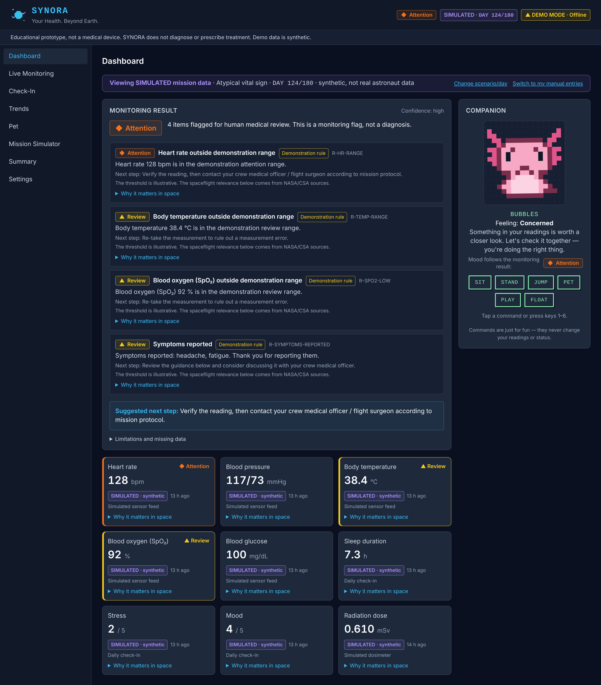

# SYNORA

**Your Health. Beyond Earth.** An offline-capable astronaut wellness monitoring *educational prototype* for the NASA Space Apps Challenge 2026 — *Create Health Monitoring Software for Astronauts on Space Missions*.

> SYNORA is **not** a medical device. It does not diagnose or prescribe treatment. All demo data is synthetic.

## Live demo

After merging to `main`, the app is published automatically to **https://aymanakhan.github.io/SYNORA/**. One-time setup: repository **Settings → Pages → Build and deployment → Source: GitHub Actions**.

## Quick start

Requires Node.js 20+.

```bash
npm install
npm run dev        # http://localhost:5173
npm test           # unit tests (Vitest)
npm run build      # type-check + production build
```

No accounts, API keys, or network access are needed for the demo.

**Offline:** `npm run build && npm run preview`, open the app once, and it will then reload with the network off (a service worker caches the app shell; health data stays in IndexedDB). The dev server (`npm run dev`) is deliberately not cached.

## Judge demo (about 3 minutes)

1. Open the app. **No login.** Choose a **cat, dog, or axolotl** and name it, then click *Start demo mission*.
2. **Dashboard:** the simulated mission (stable scenario, day 30) shows **Stable**, and the pet is happy. Every value is labelled *SIMULATED · synthetic*.
3. **Mission Simulator:** choose **Atypical vital sign**, then key day **D124 · Peak**. The result becomes **Attention**, with the rules that fired, the readings behind them, and a non-diagnostic next step. The pet becomes *concerned*. On the dashboard's **Body overview**, click the highlighted heart and lungs. Try **D132 · After** to see it recover.
4. **Live Monitoring:**
   - *Simulated Sensor Feed*: press **Start feed** to watch new mission days arrive.
   - *Connected Monitoring Device*: honestly says nothing is connected.
   - *Manual Measurement*: enter a heart rate of `400` to see it rejected, then `72`, a blood pressure of `118/76` and a temperature of `98.4 °F` (converted to °C). The dashboard switches to your manual entries.
5. **Check-In:** log `4` hours of sleep. The result becomes **Review** (short sleep) and the pet becomes concerned.
6. **Today's routine:** on the dashboard (manual entries), use **Measure now** on a reminder. Complete all six tasks and the pet earns a treat. Mistakes can be fixed with **Edit**/**Delete** in Live Monitoring → Manual and in Check-In history.
7. **Solar particle event:** in Mission Simulator, choose that scenario and **D96 · Storm peak** for a radiation attention; **D175** shows the cumulative-dose review.
8. **Pet:** try the command buttons or keys 1–4 (sit, stand, jump, pet; for the axolotl, Stand is **Float**). The status doesn't change.
9. **Reload the page:** the pet, manual entries and check-ins are still there.
10. **Trends** and **Summary:** charts with the demonstration thresholds and flagged points, plus a copyable, source-labelled summary.

## Status

| Area | State |
|---|---|
| Shared data contract, validation, unit normalization | ✅ |
| Ingestion service + IndexedDB storage (per-profile, survives reload) | ✅ |
| Assessment engine (demonstration rules, personal baseline, `unknown` handling) | ✅ |
| Live Monitoring: simulated feed / manual / device (honest "not connected") | ✅ |
| Dashboard, monitoring result, metric cards with provenance and freshness | ✅ |
| Pet companion: cat / dog / axolotl, 4 wellness states, 6 commands + keys | ✅ |
| 180-day mission simulator, 5 scenarios, timeline preview | ✅ |
| Daily check-in, trends charts, mission summary | ✅ |
| Clickable body overview (regions coloured by the shared assessment) | ✅ |
| Radiation dose-rate + cumulative mission dose rules; "Solar particle event" scenario | ✅ |
| "What you can do now" guidance on every finding | ✅ |
| Today's routine: reminders, "Measure now" links, pet stars/treats/streak | ✅ |
| Edit/Delete manual readings and check-ins; one check-in per day | ✅ |
| Display units (°C/°F, mg/dL/mmol/L, h/min, mSv/µSv) used everywhere: warnings, cards, charts, limits; set in Settings or by entering a value | ✅ |
| CI: tests + build on every pull request | ✅ |
| "Why it matters in space" explanations citing NASA HRP + CSA pages; how-to tips | ✅ |
| Offline reload via service worker (production build; tested with network off) | ✅ |
| Pet sounds (synthesized, off by default, volume) and Pixelify Sans pixel font (OFL) | ✅ |
| Camera hand gestures (MediaPipe, in-browser, opt-in): ☝ stand · 👇 sit · ✊ jump · ✋ pet | ✅ beta: see below |
| Push-to-talk voice commands (Web Speech API, disclosed) | ✅ beta: needs a real mic test |
| Auth0 accounts | not started (needs a tenant) |

## Camera gestures (optional)

On the **Pet** page, choose *Enable camera gestures*. Video is processed in the browser and is never recorded, stored or uploaded. Stopping it, or switching tabs, releases the camera. Buttons and keys 1–4 always work.

| Gesture | Command |
|---|---|
| ☝ Pointing up | stand (axolotl: float) |
| 👇 Pointing down | sit |
| ✊ Fist | jump |
| ✋ Open palm, held still | pet |

Pointing up, fist and open palm come from MediaPipe's built-in recognizer, and pointing down is worked out from the hand landmarks. An open palm must be held still briefly so a hand passing the camera doesn't trigger pet.

The MediaPipe runtime is bundled with the app. The ~8 MB gesture model is **downloaded during the GitHub Pages build** (see `.github/workflows/deploy-pages.yml`) and served from the site itself. After the first online visit, the browser caches the runtime and model, so gestures also work **offline** at the venue. Please check the model card's licence before relying on it for the submission: https://ai.google.dev/edge/mediapipe/solutions/vision/gesture_recognizer

For local runs, `npm run fetch-gesture-model` does the same download. Without the file, the app falls back to Google's hosted copy (needs internet) and says so.

**Tested:** permission denied, missing model, runtime served from our own origin, camera released after a failure, buttons unaffected (headless browser with a fake camera). **Not yet tested:** recognition with a real webcam and hand. Please try it on a laptop before the demo.

## Architecture

```
sources (manual | simulated | device-stub)
  → ingestion: validate → normalize units → provenance & quality flags
  → storage (IndexedDB, per demo profile)
  → assessment engine (pure TypeScript)
  → AssessmentResult → dashboard / alerts / charts / pet wellness
pet commands (buttons → later gesture/voice) → animation only, never health state
```

| Path | Purpose |
|---|---|
| `src/features/health/types.ts` | Shared contract: `Measurement`, `CheckIn`, `AssessmentResult`, pet types. **Coordinate before changing.** |
| `src/features/health/metrics.ts` | Metric catalog: units, hazards, input plausibility limits (not clinical thresholds) |
| `src/features/health/assessment/` | `assess()` — the single pure assessment engine; `rules.ts` holds all demonstration-only thresholds |
| `src/features/pets/wellness.ts` | `derivePetWellness()` — pet mood from the assessment result only |
| `src/features/simulation/` | Deterministic scenarios + timeline preview |
| `src/app/state.tsx` | Provider wiring storage → ingestion → assessment → UI |
| `src/services/storage/` | `HealthRepository` (IndexedDB + in-memory) |
| `src/services/ingestion/` | `validateMeasurement()` — the single entry point for every data source |
| `src/theme/tokens.ts`, `src/index.css` | Design tokens |
| `resources/nasa/reference-links.md` | Sources and review status |
| `CLAUDE.md` | Full project brief and engineering rules |

## Stack

React 18 · TypeScript · Vite · Tailwind CSS v4 · Recharts · IndexedDB (`idb`) · Vitest.

## Screenshots



## License

MIT — see [LICENSE](LICENSE).
